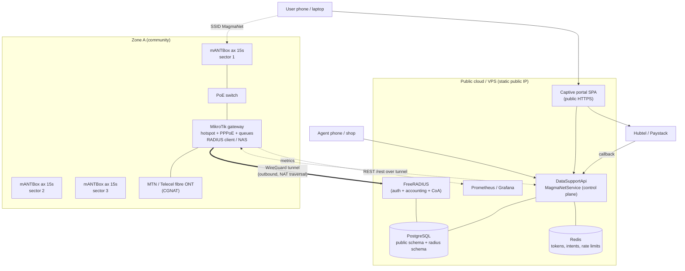
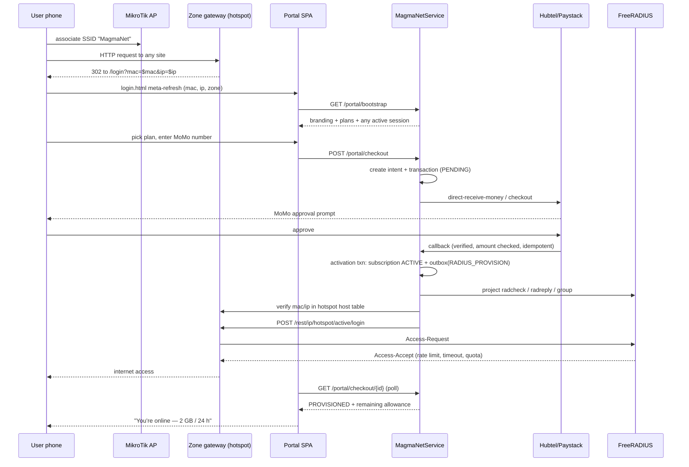

# MagmaNet Community WiFi — Implementation Plan

MagmaNet is a community WiFi service sold to walk-in users (captive portal), households
(PPPoE subscriptions) and resellers/agents (vouchers + commission wallets). The backhaul is
MTN/Telecel fibre and the radio layer is MikroTik.

This document defines the network architecture, the AAA design, the database schema, the
`MagmaNetService` API surface, the captive-portal/payment flows, the operational tooling and a
phased delivery roadmap.

> [!IMPORTANT]
> **Read section 1 before buying anything else.** MikroTik ships two products with almost the same
> name: **`mANT 15s` (`MTAS-5G-15D120`)** is a *passive antenna* — no radio, no RouterOS, cannot be
> provisioned or billed. **`mANTBox ax 15s` (`L22UGS-5HaxD2HaxD-15S`)** is the integrated unit with
> dual-band Wi-Fi 6 radios and RouterOS 7, and is fully controllable. The word **"Box"** is the whole
> difference. If your units are `mANTBox ax 15s`, nothing needs fixing; if they are `mANT 15s`, each
> sector needs a BaseBox/NetMetal radio behind it. The plan targets RouterOS devices generically so
> either build works.

---

## 0. Decisions at a glance

| # | Decision | Choice | Why |
|---|----------|--------|-----|
| 1 | AAA engine | **FreeRADIUS 3.x + PostgreSQL** | Mature, supports MikroTik VSAs, CoA, interim accounting, simultaneous-use. Writing a RADIUS server in C++ is a multi-month distraction. |
| 2 | Role of `MagmaNetService` | **Control plane only — never in the data path** | If the API is down, existing users must stay online. Billing writes are asynchronous (outbox). |
| 3 | Device management | **RouterOS v7 REST API over WireGuard** | No inbound ports needed; works behind MTN/Telecel CGNAT. |
| 4 | Access method | **MikroTik Hotspot** (walk-in) **+ PPPoE** (home) | Hotspot for prepaid/portal, PPPoE for always-on residential CPEs. Same RADIUS backend. |
| 5 | Customer identity | **MSISDN** (`magma_subscribers`) **+ MAC** (`magma_client_devices`) | Phone is the payment/account handle; MAC is the device binding. |
| 6 | Login mechanism | **API-initiated login via RouterOS REST**, not credential-in-URL | The browser is untrusted; the API verifies MAC/IP against the router's own host table. |
| 7 | Money | **Hubtel (MoMo) + Paystack (card)**, unified behind `MagmaPayService` | Existing integrations already in repo. |
| 8 | Agent commissions | **TurboLedger savings accounts** + local ledger mirror | Same pattern as the WAEC eVoucher build. |
| 9 | Voucher storage | **`code_hash` (HMAC) for redemption + `code_ciphertext` (AES-GCM) for distribution** | Agents must be able to re-print/re-send a code; a pure bcrypt hash cannot be recovered. |
| 10 | Metrics | **Prometheus/Grafana for time series**, Postgres for last-value + config | Avoid turning `radacct` into a metrics warehouse. |
| 11 | Portal hosting | **Static SPA on a public host**, talking to Drogon API | Must be reachable *pre-authentication* from every zone. |

---

## 1. Hardware reality check (do this first)

### 1.1 `mANT 15s` vs `mANTBox ax 15s` — the "Box" is the whole difference

MikroTik sells two products whose names differ by one word and whose capabilities differ completely.
Verified against `mikrotik.com/product/MTAS-5G-15D120` and `mikrotik.com/product/mantbox_ax_15s`:

| Exact product name | Code | What it actually is | Radio? |
|---|---|---|---|
| **mANT 15s** | `MTAS-5G-15D120` | **Passive** dual-polarisation 5 GHz sector antenna: 15 dBi, 120° azimuth / 10° elevation, 2 × RP-SMA, 5.17–5.825 GHz, 734 g. No CPU, no RouterOS, no connectors other than the two RF ports. ~$59. | ❌ **Antenna only** |
| **mANTBox 15s** | `RB921GS-5HPacD-15S` | Older integrated unit: RB921 720 MHz, 128 MB, 802.11ac 2×2, **5 GHz only**, RouterOS L4. | ✅ Yes — **EOL** |
| **mANTBox ax 15s** | `L22UGS-5HaxD2HaxD-15S` | Current integrated unit. **Dual-band Wi-Fi 6**: 2.4 GHz 12 dBi + 5 GHz 15 dBi, 120°, IPQ-5010 dual-core 800 MHz, 256 MB RAM, 128 MB NAND, 1 × GbE PoE-in, 1 × **2.5G SFP**, 1 × USB-A, RouterOS **v7** L4, IP55, −40…70 °C, 21 W max. ~$179. | ✅ Yes — **preferred** |
| **BaseBox 5 / NetBox 5 / NetMetal ax** | — | Separate RouterBOARD radio that drives a passive `mANT 15s` over RP-SMA pigtails. | ✅ Yes |

> [!NOTE]
> **The correction applies to `mANT 15s` only.** If your units are **`mANTBox ax 15s`**, they have
> radios, run RouterOS 7, and are controllable — there is nothing to fix. If your units are stamped
> **`mANT 15s`** / `MTAS-5G-15D120`, they are bare antennas and each one needs a radio behind it.

**If you already own passive `mANT 15s` units:** every sector needs a paired `BaseBox 5` /
`NetMetal ax` radio, a short RP-SMA pigtail and a weatherproof enclosure. That is roughly $59 +
~$100–150 of radio per sector, two boxes to mount, two devices to monitor, plus RF loss in the
pigtail.

**If you are buying new:** `mANTBox ax 15s` is the better buy — one box, one PoE run, one thing to
monitor, dual-band, Wi-Fi 6, 2.5G SFP, and RouterOS v7 (required for the REST API and WireGuard that
this design depends on).

#### Verified `mANTBox ax 15s` performance that changes the design

| Spec | Value | Why it matters here |
|---|---|---|
| 2.4 GHz radio | 802.11b/g/n/ax, 2 chains, 574 Mbit/s, **12 dBi** | Indoor handset coverage — the thing a 5 GHz-only sector fails at |
| 5 GHz radio | 802.11a/n/ac/ax, 2 chains, 2400 Mbit/s, **15 dBi** | Main sector coverage, 120° azimuth |
| PoE-in | **Passive PoE 18–28 V**, 21 W max (11 W bare) | ⚠️ **Will not run from a 48–57 V 802.3af/at switch port** |
| Copper / fibre | 1 × GbE (PoE-in) + 1 × SFP (**2.5G**) | One copper port only — see 1.2 |
| Routing (1518 B) | ~3.4 Gbps fast path; ~2.4 Gbps with 25 simple queues; ~1.7 Gbps with 25 filter rules | Can carry a whole small zone, not just be an AP |
| USB-A | 1.5 A | LTE dongle failover for a micro-zone |
| RouterOS | v7, L4, 256 MB RAM | REST + WireGuard supported; L4 session limits apply |
| Wi-Fi features | Wi-Fi 6, WPA3, 802.11r fast roaming, TWT | Clean roaming across sectors; better airtime fairness with many clients |
| Included | 24 V 1.2 A PSU, gigabit PoE injector, quickMOUNT Pro (140° adjustment), hose clamp, K-41 set | You may not need a PoE switch for 1–3 APs |

#### ⚠️ PoE compatibility trap

The passive PoE input is **18–28 V**. Standard 802.3af/at switches deliver ~48–57 V and are **not
compatible**. Options, in order of preference:

1. Use the **included 24 V PoE injectors** for a 1–3 AP site (cheapest, and gives per-AP power
   cycling for remote recovery).
2. Use a **passive-24 V PoE switch** or MikroTik `PoE-out` ports configured for `passive` with the
   correct voltage — not `auto`, which may negotiate 802.3af.
3. Never mix a 48 V injector onto these units "just to test"; it is a dead AP.

#### A 2.4 GHz radio is now in the box

If you were planning to bolt on a separate 2.4 GHz radio for indoor phones, you do not need to with
`mANTBox ax 15s`: each sector radiates both bands from the same 120° panel
(12 dBi @ 2.4 GHz, 15 dBi @ 5 GHz). For a 3-sector zone that means **three dual-band sectors cover
360°** — publish one SSID, steer handsets to 2.4 GHz and CPEs/laptops to 5 GHz via band steering or
separate SSIDs, and keep 2.4 GHz on 20 MHz with 1/6/11 only.

### 1.2 The device that actually matters: the zone gateway

For anything beyond a single sector, the gateway is the **single choke point and the RADIUS NAS** for
a zone. Recommended:

- `RB5009UG+S+IN` (1 × 2.5G + 7 × 1G, SFP+, RouterOS L5) for a 100–300 Mbps zone, or
- `CCR2004-1G-12S+2XS` for a multi-sector aggregation site, or
- `hEX S` for a small pilot zone (≤ 50 users, ≤ 100 Mbps).

The APs are **bridged** to the gateway; the hotspot instance, DHCP, queues, firewall and RADIUS
client all live on the gateway. One NAS per zone = one shared secret, one place to look when
authentication breaks.

#### Micro-zone option: one `mANTBox ax 15s` does everything

Because the ax unit routes ~3.4 Gbps fast path and runs RouterOS 7, a **single-sector micro-zone**
(kiosk, school gate, small compound, pilot site) can be one device: AP + hotspot + WireGuard +
RADIUS client + queues. No gateway, no switch. Caveats:

- **One copper port only.** If the ONT uses that port for WAN, the unit is a
  "router-on-a-stick": WAN and guest LAN share one 1 GbE link via VLANs to a small switch, which
  halves usable throughput. On a ≤100 Mbps backhaul that is acceptable; above that, use the SFP for
  the uplink or add a gateway.
- **Passive PoE 18–28 V** (see the trap above).
- **CPU headroom:** the quoted 3.4 Gbps is fast-path switching. Hotspot + firewall + WireGuard
  encryption on an 800 MHz IPQ-5010 will be far lower. **Field-test WireGuard throughput before
  committing a micro-zone to this design** — target ≥ 150 Mbps sustained on the tunnel, otherwise
  terminate the tunnel on a gateway and bridge the AP.
- **L4 licence session limits.** Fine for hotspot; verify MikroTik's licence feature table before
  consolidating a large PPPoE subscriber base onto one unit.

Use the dedicated-gateway topology for anything with 2+ sectors, PPPoE home subscribers, or a
backhaul above 100 Mbps.

### 1.3 Suggested bill of materials per 3-sector zone

| Item | Qty | Notes |
|---|---|---|
| Zone gateway (RB5009 / CCR2004) | 1 | Hotspot + queues + WireGuard + PPPoE server. Omit for the single-sector micro-zone. |
| `mANTBox ax 15s` (or passive `mANT 15s` + BaseBox 5) | 3 | 3 × 120° ≈ 360°, **dual-band** (2.4 GHz 12 dBi + 5 GHz 15 dBi) |
| Passive-24 V PoE distribution | 3 ports | **Not** a 48 V 802.3af/at switch. Included injectors are fine for 1–3 APs; otherwise a passive-PoE switch. |
| Managed switch for VLANs (CRS326 / netPower) | 1 | Guest / management / backhaul separation. Needs PoE only if powering APs from it. |
| Outdoor Cat6, UV-rated, gel-filled | 3 runs | ≤ 100 m per run |
| Ethernet surge arrestor + grounding kit | 3 | Non-negotiable in Accra's storm season |
| UPS (1–2 kVA, 4–8 h) or solar + LiFePO4 | 1 | Grid outages are the #1 uptime killer |
| Mast / wall bracket, downtilt mount | 3 | 8–15 m AGL; `mANTBox ax` ships with quickMOUNT Pro |
| Backhaul ONT (MTN/Telecel provided) | 1 | Terminate into gateway WAN |
| Optional: USB LTE dongle | 1 | Failover on a micro-zone (`mANTBox ax` USB-A, 1.5 A) |
| Optional: 5 GHz CPE for home subs (LHG / LDF) | n | Only if selling PPPoE residential |

### 1.4 RF planning notes

- **With `mANTBox ax 15s`, both bands come from each 120° sector** (12 dBi @ 2.4 GHz, 15 dBi @
  5 GHz). Practical radius: 2.4 GHz reaches indoor handsets ~150–250 m; 5 GHz carries laptops/CPEs
  ~300–500 m LOS. That dual-band coverage is the main reason to prefer the ax unit over the old
  5 GHz-only mANTBox.
- **If you run passive `mANT 15s`, you have 5 GHz only.** Phones indoors behind a wall will usually
  fail. Add a 2.4 GHz radio per site or lead with home CPEs instead of handsets.
- Use **20 MHz channels** on both bands. 40/80 MHz only for dedicated PtP backhaul. Fewer retries,
  more clients, less interference. 2.4 GHz limited to 1/6/11.
- **Band steering:** one SSID with steering is friendliest for customers, but cheap Android handsets
  sometimes stick to 5 GHz at the edge. Consider publishing `MagmaNet` (2.4 GHz) and
  `MagmaNet-5G` (5 GHz) and letting CPE installs use the 5 GHz SSID.
- Uplink/downlink asymmetry is real: a handset transmits at ~15 dBm, the AP at 20–28 dBm. The link
  will look "connected" but upload will be poor at cell edge. Set a **minimum signal / CCQ admission
  policy** on the AP (`/interface/wireless/security-profiles` + access-list) rather than letting
  weak clients drag airtime down.
- Non-overlapping channel reuse between sectors; avoid DFS where cheap handsets refuse to join.
- Wi-Fi 6 gives you WPA3, 802.11r fast roaming and better airtime fairness under load — all useful
  for a crowded community site, and all wasted if you leave legacy rates enabled. Disable 802.11b
  rates on 2.4 GHz.
- Ground the mast, surge-protect every outdoor Ethernet run, and use shielded cable. One lightning
  strike can take out the switch, the gateway and the ONT simultaneously.

---

## 2. Reference architecture



### 2.1 Why a WireGuard tunnel is mandatory

MTN and Telecel consumer fibre present **CGNAT / private addresses** by default; a static public IP
is an add-on (commonly quoted around GHS 1,300/year, sometimes bundled on business unlimited plans
— confirm with your account manager). Without a public IP:

- RADIUS auth/accounting (UDP 1812/1813) cannot be initiated from the cloud to the router,
- CoA/disconnect (UDP 3799) cannot reach the router,
- REST management cannot reach the router.

So: every gateway runs a WireGuard client with `persistent-keepalive=25`, connecting outbound to the
VPS. Tunnel addressing plan:

| Object | Range | Notes |
|---|---|---|
| WG server | `10.200.0.1/24` | On the VPS |
| Gateways | `10.200.1.0/24` (`10.200.1.<zone_no>`) | One key per device, revoked on decommission |
| RADIUS/API reachable at | `10.200.0.2` (RADIUS), `10.200.0.3` (API) | Firewall: allow only those + DNS/NTP from tunnels |
| Customer LAN per zone | `10.10.<zone_no>.0/24` | Hotspot pool `10.10.<zone_no>.64/26` |

If the tunnel drops, the hotspot keeps authenticating from its **local user cache** and existing
sessions continue — revenue stops only for *new* purchases. That is the correct failure mode.

### 2.2 Two access products, one backend

| Product | Access method | Identity | Billing |
|---|---|---|---|
| Walk-in / community | Hotspot + captive portal | MAC + MSISDN | Prepaid bundle (time or volume), voucher |
| Home / small business | PPPoE over 5 GHz CPE | PPPoE username = MSISDN | Monthly invoice / prepaid month |

Both terminate on FreeRADIUS, both produce `radacct` rows, and both roll up into the same revenue
and usage reports.

---

## 3. AAA design (FreeRADIUS)

### 3.1 Options considered

| Option | Verdict |
|---|---|
| RouterOS **User Manager** | Fastest to demo, but limited multi-zone reporting, awkward API, weak backup story. Rejected for scale; acceptable for a 2-day field pilot. |
| Push hotspot users directly via REST, no RADIUS | No accounting history, no CoA, no cross-session quota. Rejected. |
| **FreeRADIUS + Postgres, API as control plane** | Chosen. |
| Custom RADIUS server in C++/Drogon | Rejected — packet retransmits, proxy, dictionaries, EAP, `Simultaneous-Use` are all solved problems. |

### 3.2 Schema separation

- `public` schema: all Drogon-generated models and MagmaNet tables.
- `radius` schema: standard FreeRADIUS 3 tables (`nas`, `radcheck`, `radreply`, `radgroupcheck`,
  `radgroupreply`, `radusergroup`, `radacct`, `radpostauth`).

Two DB clients in `config.json`: `default` (full rights on `public`) and `radius` (INSERT/UPDATE/DELETE
on `radius` only). This keeps FreeRADIUS upgrades independent and prevents an API bug from touching
accounting tables.

### 3.3 Username conventions

| Prefix | Meaning | Password | MAC bound |
|---|---|---|---|
| `mg:<subscription_id>` | Hotspot subscription | 32-char random secret, encrypted at rest, known only to the API | Yes (`Calling-Station-Id`) unless `device_limit > 1` |
| `mgp:<subscriber_id>` | PPPoE home subscriber | Subscriber-chosen / generated | No (CPE identity is the PPPoE secret) |
| `mgv:<voucher_id>` | Voucher redeem path (short-lived, then converted to `mg:`) | Voucher code (hashed lookup) | Bound at redemption |

Deterministic usernames mean `radacct.username` maps straight back to a subscription with no extra
lookup table.

### 3.4 What the API writes per subscription

```text
radius.radcheck
  username                       mg:<sub_id>
  attribute = 'Cleartext-Password', op = ':=', value = <secret>
  -- optional hard MAC binding:
  username, 'Calling-Station-Id', '==', '<mac>'

radius.radreply
  'Mikrotik-Rate-Limit'            = '<up_kbps>k/<down_kbps>k'         (rx/tx = upload/download)
  'Session-Timeout'                = <remaining_seconds, capped 86400>
  'Idle-Timeout'                   = 1800
  'Acct-Interim-Interval'          = 60
  'Mikrotik-Total-Limit'           = <remaining_bytes mod 2^32>
  'Mikrotik-Total-Limit-Gigawords' = <remaining_bytes div 2^32>
  'Mikrotik-Group'                 = 'magma-<plan_code>'                (hotspot profile w/ shared-users)

radius.radusergroup
  mg:<sub_id>  ->  magma-<plan_code>
```

Plan-level defaults live in `radgroupreply`; per-user overrides in `radreply`. Changing a plan's
speed = update one group row + CoA, not 4,000 user rows.

### 3.5 Enforcement model (the part that decides whether you make money)

RouterOS applies `Session-Timeout` and byte limits **per session**, so a naïve implementation lets a
user reset their allowance by reconnecting. Use three layers:

1. **Session-level cap (router):** on every Access-Accept the API computes *remaining* time and
   *remaining* bytes for that subscription and publishes them. A reconnect gets only what is left.
   `Mikrotik-Total-Limit` is 32-bit, so split across `...-Gigawords` for >4 GB plans.
2. **Cross-session ledger (API):** a 60-second worker reads `radacct` interim counters, converts
   them to deltas against the last-seen values in `magma_sessions`, and increments
   `magma_subscriptions.used_mb` / `used_seconds` inside a row lock.
3. **Cut-off (CoA):** when `used_mb >= purchased_mb` or `now() > expires_at`, the API marks the
   subscription `DEPLETED`/`EXPIRED`, invalidates the RADIUS credential, and sends a
   **Disconnect-Request (RFC 5176, UDP 3799)** keyed on `Acct-Session-Id`.

For unlimited plans, crossing the fair-use threshold triggers a **CoA-Request** that swaps the
rate-limit to the throttled value instead of disconnecting.

> [!NOTE]
> Field-verify the `Mikrotik-Rate-Limit` direction on day one (`rx/tx` is from the router's
> perspective: rx = client upload). A reversed limit is the single most common "why is upload fast
> and download slow" bug.

### 3.6 Accounting and reconciliation

- `Acct-Interim-Interval = 60` balances enforcement latency against `radacct` write volume.
  At 1,000 concurrent sessions that is ~17 UPDATEs/s — trivial. At 10,000 sessions, move to 5-minute
  interim updates and rely on volume caps at the session edge, or partition/offload `radacct`.
- `radacct` is **partitioned monthly** on `acctstarttime`; retain 12 months hot, archive older.
- Nightly reconciliation: sum `radacct` per subscription vs `magma_subscriptions.used_mb`; report
  drift > 2 %. Any drift means the interim worker is missing packets or double-counting stops.

---

## 4. Data model

All tables carry `business_id` so one deployment can serve multiple operators/franchisees, matching
the existing `BusinessAccounts` pattern. Money is `NUMERIC(12,2)`; Drogon maps `DECIMAL` to
`std::string`, which the existing models already handle.

### 4.1 Zones and assets

```sql
CREATE TABLE magma_zones (
    id                       UUID PRIMARY KEY,
    business_id              UUID NOT NULL REFERENCES business_accounts(id),
    zone_code                VARCHAR(24) NOT NULL,          -- e.g. "ACC-MADINA-01"
    name                     VARCHAR(120) NOT NULL,
    district                 VARCHAR(80)  NOT NULL,
    region                   VARCHAR(80)  NOT NULL,
    gps_lat                  NUMERIC(9,6),
    gps_lng                  NUMERIC(9,6),
    backhaul_provider        VARCHAR(24),                   -- MTN_FIBRE | TELECEL_FIBRE | OTHER
    backhaul_circuit_ref     VARCHAR(64),
    upstream_down_mbps       NUMERIC(8,2),
    upstream_up_mbps         NUMERIC(8,2),
    upstream_monthly_cost    NUMERIC(12,2),
    upstream_is_cgnat        BOOLEAN DEFAULT TRUE,
    public_ip                INET,
    tunnel_ip                INET,
    timezone                 VARCHAR(64) DEFAULT 'Africa/Accra',
    status                   VARCHAR(16) DEFAULT 'PLANNED',  -- PLANNED|BUILD|LIVE|PAUSED|RETIRED
    launched_at              TIMESTAMPTZ,
    created_at               TIMESTAMPTZ DEFAULT now(),
    updated_at               TIMESTAMPTZ DEFAULT now(),
    UNIQUE (business_id, zone_code)
);

CREATE TABLE magma_devices (
    id                       UUID PRIMARY KEY,
    business_id              UUID NOT NULL,
    zone_id                  UUID REFERENCES magma_zones(id),
    name                     VARCHAR(120) NOT NULL,
    role                     VARCHAR(16) NOT NULL,          -- GATEWAY|AP|SWITCH|CPE|ONT|UPS
    vendor                   VARCHAR(32) DEFAULT 'MikroTik',
    model                    VARCHAR(64),
    serial_number            VARCHAR(64) UNIQUE,
    mac_address              MACADDR,
    routeros_version         VARCHAR(24),
    management_ip            INET,
    tunnel_ip                INET,
    rest_port                INT DEFAULT 443,
    api_username             VARCHAR(64),
    api_secret_ciphertext    BYTEA,                          -- AES-GCM, key from env
    radius_secret_ciphertext BYTEA,
    enrolment_status         VARCHAR(16) DEFAULT 'PENDING',  -- PENDING|ENROLLED|REVOKED
    status                   VARCHAR(16) DEFAULT 'UNKNOWN',  -- ONLINE|OFFLINE|DEGRADED|UNKNOWN
    last_seen_at             TIMESTAMPTZ,
    uptime_seconds           BIGINT,
    cpu_load                 SMALLINT,
    free_memory_mb           INT,
    temperature_c            NUMERIC(5,2),
    installed_at             DATE,
    notes                    TEXT,
    created_at               TIMESTAMPTZ DEFAULT now(),
    updated_at               TIMESTAMPTZ DEFAULT now()
);

-- Devices that belong to customers (CPE / installed router)
ALTER TABLE magma_devices
    ADD COLUMN assigned_subscriber_id UUID,
    ADD COLUMN asset_cost NUMERIC(12,2);
```

### 4.2 Plans

```sql
CREATE TABLE magma_data_plans (
    id                    UUID PRIMARY KEY,
    business_id           UUID NOT NULL,
    plan_code             VARCHAR(32) NOT NULL,
    name                  VARCHAR(80) NOT NULL,
    plan_type             VARCHAR(16) NOT NULL,             -- TIME | VOLUME | UNLIMITED
    duration_minutes      INT,                              -- TIME
    data_cap_mb           BIGINT,                           -- VOLUME
    fair_use_cap_mb       BIGINT,                           -- UNLIMITED: throttle after
    throttle_down_kbps    INT,
    throttle_up_kbps      INT,
    down_kbps             INT NOT NULL,
    up_kbps               INT NOT NULL,
    burst_down_kbps       INT,
    burst_up_kbps         INT,
    device_limit          SMALLINT DEFAULT 1,
    price                 NUMERIC(12,2) NOT NULL,
    wholesale_price       NUMERIC(12,2),
    agent_commission      NUMERIC(12,2) DEFAULT 0,
    tax_inclusive         BOOLEAN DEFAULT TRUE,
    validity_days         SMALLINT DEFAULT 30,              -- voucher / top-up validity
    is_public             BOOLEAN DEFAULT TRUE,
    is_active             BOOLEAN DEFAULT TRUE,
    sort_order            SMALLINT DEFAULT 0,
    effective_from        TIMESTAMPTZ DEFAULT now(),
    effective_to          TIMESTAMPTZ,
    created_at            TIMESTAMPTZ DEFAULT now(),
    updated_at            TIMESTAMPTZ DEFAULT now(),
    UNIQUE (business_id, plan_code)
);

-- Empty set for a plan = available in every zone
CREATE TABLE magma_plan_zones (
    plan_id UUID NOT NULL REFERENCES magma_data_plans(id) ON DELETE CASCADE,
    zone_id UUID NOT NULL REFERENCES magma_zones(id) ON DELETE CASCADE,
    PRIMARY KEY (plan_id, zone_id)
);
```

### 4.3 Subscribers and devices

```sql
CREATE TABLE magma_subscribers (
    id                      UUID PRIMARY KEY,
    business_id             UUID NOT NULL,
    msisdn                  VARCHAR(20) NOT NULL,           -- E.164, E.164-normalised
    full_name               VARCHAR(120),
    email                   VARCHAR(120),
    ghana_card_ciphertext   BYTEA,
    ghana_card_masked       VARCHAR(16),
    subscriber_type         VARCHAR(16) DEFAULT 'WALK_IN',   -- WALK_IN|RESIDENTIAL|BUSINESS
    auth_type               VARCHAR(16) DEFAULT 'HOTSPOT',   -- HOTSPOT|PPPOE
    pppoe_username          VARCHAR(64),
    pppoe_secret_ciphertext BYTEA,
    home_zone_id            UUID REFERENCES magma_zones(id),
    service_address         TEXT,
    gps_lat                 NUMERIC(9,6),
    gps_lng                 NUMERIC(9,6),
    status                  VARCHAR(16) DEFAULT 'ACTIVE',    -- ACTIVE|SUSPENDED|CHURNED
    kyc_status              VARCHAR(16) DEFAULT 'NOT_REQUIRED',
    consent_at              TIMESTAMPTZ,
    consent_version         VARCHAR(16),
    first_seen_at           TIMESTAMPTZ,
    last_seen_at            TIMESTAMPTZ,
    created_at              TIMESTAMPTZ DEFAULT now(),
    updated_at              TIMESTAMPTZ DEFAULT now(),
    UNIQUE (business_id, msisdn)
);

CREATE TABLE magma_client_devices (
    id             UUID PRIMARY KEY,
    business_id    UUID NOT NULL,
    subscriber_id  UUID NOT NULL REFERENCES magma_subscribers(id) ON DELETE CASCADE,
    mac_address    MACADDR NOT NULL,
    label          VARCHAR(64),
    first_seen_at  TIMESTAMPTZ DEFAULT now(),
    last_seen_at   TIMESTAMPTZ,
    is_blocked     BOOLEAN DEFAULT FALSE,
    blocked_reason TEXT,
    UNIQUE (business_id, mac_address)
);
```

### 4.4 Subscriptions, sessions, payments

```sql
CREATE TABLE magma_subscriptions (
    id                 UUID PRIMARY KEY,
    business_id        UUID NOT NULL,
    subscriber_id      UUID NOT NULL REFERENCES magma_subscribers(id),
    plan_id            UUID NOT NULL REFERENCES magma_data_plans(id),
    zone_id            UUID NOT NULL REFERENCES magma_zones(id),
    radius_username    VARCHAR(64) NOT NULL UNIQUE,
    radius_secret_ct   BYTEA NOT NULL,
    status             VARCHAR(16) NOT NULL,               -- PENDING|ACTIVE|EXPIRED|DEPLETED|SUSPENDED|CANCELLED
    purchased_minutes  INT,
    purchased_mb       BIGINT,
    used_seconds       BIGINT DEFAULT 0,
    used_mb            BIGINT DEFAULT 0,
    starts_at          TIMESTAMPTZ,
    expires_at         TIMESTAMPTZ,
    activated_at       TIMESTAMPTZ,
    ended_at           TIMESTAMPTZ,
    plan_snapshot      JSONB NOT NULL,                     -- price/cap/speed at time of sale
    payment_id         UUID,
    voucher_id         UUID,
    agent_id           UUID,
    parent_id          UUID REFERENCES magma_subscriptions(id),  -- top-up chain
    auto_renew         BOOLEAN DEFAULT FALSE,
    created_at         TIMESTAMPTZ DEFAULT now(),
    updated_at         TIMESTAMPTZ DEFAULT now()
);
CREATE INDEX idx_magma_subs_enforce ON magma_subscriptions (status, expires_at);
CREATE INDEX idx_magma_subs_subscriber ON magma_subscriptions (subscriber_id, created_at DESC);

CREATE TABLE magma_sessions (
    id               UUID PRIMARY KEY,
    business_id      UUID NOT NULL,
    subscription_id  UUID NOT NULL REFERENCES magma_subscriptions(id),
    subscriber_id    UUID NOT NULL,
    zone_id          UUID NOT NULL,
    device_id        UUID REFERENCES magma_devices(id),
    acct_session_id  VARCHAR(128) NOT NULL UNIQUE,
    nas_ip           INET,
    framed_ip        INET,
    mac_address      MACADDR,
    started_at       TIMESTAMPTZ NOT NULL,
    last_interim_at  TIMESTAMPTZ,
    ended_at         TIMESTAMPTZ,
    last_input_octets  BIGINT DEFAULT 0,
    last_output_octets BIGINT DEFAULT 0,
    input_octets     BIGINT DEFAULT 0,
    output_octets    BIGINT DEFAULT 0,
    session_seconds  BIGINT DEFAULT 0,
    terminate_cause  VARCHAR(48)
) PARTITION BY RANGE (started_at);

CREATE TABLE magma_transactions (
    id                 UUID PRIMARY KEY,
    business_id        UUID NOT NULL,
    subscriber_id      UUID,
    subscription_id    UUID,
    agent_id           UUID,
    voucher_id         UUID,
    purpose            VARCHAR(24) NOT NULL,               -- BUNDLE|TOPUP|VOUCHER_STOCK|SETTLEMENT|REFUND
    amount             NUMERIC(12,2) NOT NULL,
    tax_amount         NUMERIC(12,2) DEFAULT 0,
    net_amount         NUMERIC(12,2),
    tax_breakdown      JSONB,
    currency           CHAR(3) DEFAULT 'GHS',
    payment_method     VARCHAR(24),                        -- MOMO_MTN|MOMO_TELECEL|MOMO_AT|CARD|CASH|WALLET
    provider           VARCHAR(24),                        -- HUBTEL|PAYSTACK|INTERNAL
    provider_reference VARCHAR(128),
    internal_reference VARCHAR(64) UNIQUE,
    status             VARCHAR(16) NOT NULL,               -- PENDING|SUCCESS|FAILED|REVERSED
    payer_msisdn       VARCHAR(20),
    failure_reason     TEXT,
    raw_callback       JSONB,
    initiated_at       TIMESTAMPTZ DEFAULT now(),
    paid_at            TIMESTAMPTZ,
    created_at         TIMESTAMPTZ DEFAULT now(),
    updated_at         TIMESTAMPTZ DEFAULT now(),
    UNIQUE (provider, provider_reference)
);

CREATE TABLE magma_checkout_intents (
    id              UUID PRIMARY KEY,
    business_id     UUID NOT NULL,
    zone_id         UUID NOT NULL,
    plan_id         UUID NOT NULL,
    mac_address     MACADDR NOT NULL,
    ip_address      INET,
    msisdn          VARCHAR(20),
    subscriber_id   UUID,
    transaction_id  UUID,
    status          VARCHAR(16) DEFAULT 'NEW',             -- NEW|AWAITING_PAYMENT|PAID|PROVISIONED|FAILED|EXPIRED
    login_attempts  SMALLINT DEFAULT 0,
    expires_at      TIMESTAMPTZ NOT NULL,
    created_at      TIMESTAMPTZ DEFAULT now(),
    updated_at      TIMESTAMPTZ DEFAULT now()
);
```

**Snapshots matter:** `plan_snapshot` freezes price, cap and speed at the time of sale. Without it,
a price change silently rewrites history and your revenue reports stop reconciling.

### 4.5 Vouchers and agents

```sql
CREATE TABLE magma_voucher_batches (
    id               UUID PRIMARY KEY,
    business_id      UUID NOT NULL,
    batch_code       VARCHAR(32) NOT NULL UNIQUE,
    plan_id          UUID NOT NULL REFERENCES magma_data_plans(id),
    zone_id          UUID REFERENCES magma_zones(id),
    quantity         INT NOT NULL,
    unit_price       NUMERIC(12,2) NOT NULL,
    wholesale_price  NUMERIC(12,2) NOT NULL,
    owner_type       VARCHAR(16) DEFAULT 'BUSINESS',        -- BUSINESS|AGENT
    owner_agent_id   UUID,
    status           VARCHAR(16) DEFAULT 'DRAFT',           -- DRAFT|ACTIVE|EXHAUSTED|VOID
    expires_at       TIMESTAMPTZ,
    created_by       UUID,
    created_at       TIMESTAMPTZ DEFAULT now()
);

CREATE TABLE magma_vouchers (
    id                      UUID PRIMARY KEY,
    business_id             UUID NOT NULL,
    batch_id                UUID NOT NULL REFERENCES magma_voucher_batches(id),
    plan_id                 UUID NOT NULL,
    zone_id                 UUID,
    serial                  VARCHAR(32) NOT NULL UNIQUE,
    code_hash               BYTEA NOT NULL UNIQUE,          -- HMAC-SHA256(code, pepper)
    code_ciphertext         BYTEA NOT NULL,                 -- AES-GCM, only decryptable by authorised roles
    status                  VARCHAR(16) DEFAULT 'AVAILABLE',-- AVAILABLE|ASSIGNED|SOLD|REDEEMED|EXPIRED|VOID
    agent_id                UUID,
    price                   NUMERIC(12,2),
    commission              NUMERIC(12,2),
    sold_at                 TIMESTAMPTZ,
    redeemed_at             TIMESTAMPTZ,
    redeemed_subscriber_id  UUID,
    subscription_id         UUID,
    created_at              TIMESTAMPTZ DEFAULT now(),
    updated_at              TIMESTAMPTZ DEFAULT now()
);
CREATE INDEX idx_magma_vouchers_agent ON magma_vouchers (agent_id, status);

CREATE TABLE magma_agents (
    id                 UUID PRIMARY KEY,
    business_id        UUID NOT NULL,
    agent_code         VARCHAR(24) NOT NULL UNIQUE,
    name               VARCHAR(120) NOT NULL,
    msisdn             VARCHAR(20) NOT NULL,                 -- unique per business
    email              VARCHAR(120),
    pin_hash           VARCHAR(255) NOT NULL,                -- bcrypt
    tier               VARCHAR(24) DEFAULT 'STANDARD',
    commission_rate    NUMERIC(5,2) DEFAULT 0,
    territory_zone_id  UUID REFERENCES magma_zones(id),
    wallet_account_id  VARCHAR(64),                          -- TurboLedger savings account
    status             VARCHAR(16) DEFAULT 'ACTIVE',
    kyc_status         VARCHAR(16) DEFAULT 'PENDING',
    created_at         TIMESTAMPTZ DEFAULT now(),
    updated_at         TIMESTAMPTZ DEFAULT now()
);

CREATE TABLE magma_agent_ledger (
    id              UUID PRIMARY KEY,
    business_id     UUID NOT NULL,
    agent_id        UUID NOT NULL REFERENCES magma_agents(id),
    entry_type      VARCHAR(16) NOT NULL,                    -- EARNING|PAYOUT|ADJUSTMENT|STOCK_PURCHASE
    amount          NUMERIC(12,2) NOT NULL,                  -- signed
    balance_after   NUMERIC(12,2) NOT NULL,
    reference       VARCHAR(64) UNIQUE,
    transaction_id  UUID,
    voucher_id      UUID,
    description     TEXT,
    created_at      TIMESTAMPTZ DEFAULT now()
);
```

### 4.6 Operations, finance, plumbing

```sql
CREATE TABLE magma_invoices (
    id              UUID PRIMARY KEY,
    business_id     UUID NOT NULL,
    subscriber_id   UUID NOT NULL,
    subscription_id UUID,
    invoice_number  VARCHAR(32) UNIQUE NOT NULL,
    period_start    DATE NOT NULL,
    period_end      DATE NOT NULL,
    subtotal        NUMERIC(12,2) NOT NULL,
    tax_amount      NUMERIC(12,2) NOT NULL,
    total           NUMERIC(12,2) NOT NULL,
    amount_paid     NUMERIC(12,2) DEFAULT 0,
    status          VARCHAR(16) DEFAULT 'DRAFT',             -- DRAFT|ISSUED|PAID|OVERDUE|VOID
    due_at          DATE,
    issued_at       TIMESTAMPTZ,
    paid_at         TIMESTAMPTZ,
    created_at      TIMESTAMPTZ DEFAULT now()
);

CREATE TABLE magma_zone_costs (
    id            UUID PRIMARY KEY,
    business_id   UUID NOT NULL,
    zone_id       UUID NOT NULL REFERENCES magma_zones(id),
    category      VARCHAR(24) NOT NULL,                      -- BACKHAUL|POWER|RENT|STAFF|TRANSPORT|OTHER
    amount        NUMERIC(12,2) NOT NULL,
    period_start  DATE NOT NULL,
    period_end    DATE NOT NULL,
    vendor        VARCHAR(120),
    reference     VARCHAR(64),
    notes         TEXT,
    created_at    TIMESTAMPTZ DEFAULT now()
);

CREATE TABLE magma_tickets (
    id            UUID PRIMARY KEY,
    business_id   UUID NOT NULL,
    zone_id       UUID,
    subscriber_id UUID,
    agent_id      UUID,
    category      VARCHAR(24) NOT NULL,                      -- NO_INTERNET|SLOW|BILLING|INSTALLATION|OTHER
    priority      VARCHAR(8) DEFAULT 'NORMAL',
    status        VARCHAR(16) DEFAULT 'OPEN',                 -- OPEN|IN_PROGRESS|RESOLVED|CLOSED
    subject       VARCHAR(160) NOT NULL,
    description   TEXT,
    assigned_to   UUID,
    sla_due_at    TIMESTAMPTZ,
    resolved_at   TIMESTAMPTZ,
    created_at    TIMESTAMPTZ DEFAULT now(),
    updated_at    TIMESTAMPTZ DEFAULT now()
);

CREATE TABLE magma_ticket_messages (
    id          UUID PRIMARY KEY,
    ticket_id   UUID NOT NULL REFERENCES magma_tickets(id) ON DELETE CASCADE,
    author_type VARCHAR(16) NOT NULL,                         -- SUBSCRIBER|STAFF|SYSTEM
    author_id   UUID,
    body        TEXT NOT NULL,
    created_at  TIMESTAMPTZ DEFAULT now()
);

CREATE TABLE magma_work_orders (
    id             UUID PRIMARY KEY,
    business_id    UUID NOT NULL,
    zone_id        UUID,
    subscriber_id  UUID,
    order_type     VARCHAR(16) NOT NULL,                      -- INSTALL|REPAIR|RECOVERY|DEINSTALL
    status         VARCHAR(16) DEFAULT 'SCHEDULED',           -- SCHEDULED|EN_ROUTE|DONE|CANCELLED
    assigned_to    UUID,
    scheduled_at   TIMESTAMPTZ,
    checklist      JSONB,
    materials      JSONB,
    photos         JSONB,
    cost           NUMERIC(12,2) DEFAULT 0,
    completed_at   TIMESTAMPTZ,
    created_at     TIMESTAMPTZ DEFAULT now()
);

CREATE TABLE magma_staff (
    id            UUID PRIMARY KEY,
    business_id   UUID NOT NULL,
    full_name     VARCHAR(120) NOT NULL,
    msisdn        VARCHAR(20),
    email         VARCHAR(120),
    pin_hash      VARCHAR(255) NOT NULL,
    role          VARCHAR(24) NOT NULL,                       -- ADMIN|OPS|TECHNICIAN|SUPPORT|FINANCE|AGENT_MANAGER
    zone_ids      UUID[],
    status        VARCHAR(16) DEFAULT 'ACTIVE',
    last_login_at TIMESTAMPTZ,
    created_at    TIMESTAMPTZ DEFAULT now()
);

CREATE TABLE magma_alerts (
    id              BIGSERIAL PRIMARY KEY,
    business_id     UUID NOT NULL,
    zone_id         UUID,
    device_id       UUID,
    alert_type      VARCHAR(32) NOT NULL,                     -- DEVICE_OFFLINE|BACKHAUL_DOWN|HIGH_LATENCY|CAPACITY|AUTH_FAIL_SPIKE|TAMPER|LOW_STOCK
    severity        VARCHAR(8) NOT NULL,                      -- INFO|WARN|CRITICAL
    message         TEXT NOT NULL,
    payload         JSONB,
    acknowledged_by UUID,
    acknowledged_at TIMESTAMPTZ,
    resolved_at     TIMESTAMPTZ,
    created_at      TIMESTAMPTZ DEFAULT now()
);

-- Transactional outbox: every side effect (RADIUS projection, SMS, CoA, commission) is a row.
CREATE TABLE magma_outbox (
    id              BIGSERIAL PRIMARY KEY,
    event_type      VARCHAR(48) NOT NULL,                     -- RADIUS_PROVISION|COA_DISCONNECT|SMS_SEND|AGENT_COMMISSION|INVOICE_ISSUE
    aggregate_id    UUID,
    payload         JSONB NOT NULL,
    status          VARCHAR(16) DEFAULT 'PENDING',             -- PENDING|DONE|FAILED|DEAD
    attempts        SMALLINT DEFAULT 0,
    next_attempt_at TIMESTAMPTZ DEFAULT now(),
    last_error      TEXT,
    created_at      TIMESTAMPTZ DEFAULT now(),
    processed_at    TIMESTAMPTZ
);
CREATE INDEX idx_magma_outbox_due ON magma_outbox (status, next_attempt_at);

CREATE TABLE magma_audit_log (
    id          BIGSERIAL PRIMARY KEY,
    business_id UUID,
    actor_type  VARCHAR(16),
    actor_id    UUID,
    action      VARCHAR(64) NOT NULL,
    entity      VARCHAR(64) NOT NULL,
    entity_id   UUID,
    before      JSONB,
    after       JSONB,
    ip_address  INET,
    created_at  TIMESTAMPTZ DEFAULT now()
);
```

### 4.7 FreeRADIUS tables

Use the stock FreeRADIUS 3 PostgreSQL schema in the `radius` schema, with these additions:

```sql
-- MikroTik NAS registry (FreeRADIUS reads clients from here: read_clients = yes)
CREATE TABLE radius.nas (
    id          SERIAL PRIMARY KEY,
    nasname     VARCHAR(128) NOT NULL,      -- tunnel IP of the zone gateway
    shortname   VARCHAR(32)  NOT NULL,      -- zone_code
    type        VARCHAR(30)  DEFAULT 'other',
    ports       INT,
    secret      VARCHAR(60)  NOT NULL,
    server      VARCHAR(64),
    description VARCHAR(200)
);

-- Indexes that matter at scale
CREATE INDEX idx_radacct_user_start ON radius.radacct (username, acctstarttime DESC);
CREATE INDEX idx_radacct_active ON radius.radacct (acctstoptime) WHERE acctstoptime IS NULL;
CREATE INDEX idx_radcheck_user ON radius.radcheck (username);
```

`radacct` and `magma_sessions` are partitioned identically (monthly), created by the migration job.

---

## 5. `MagmaNetService` design

### 5.1 Shape

`MagmaNetService` is the **facade** the controllers and plugin talk to. It owns the transaction
boundaries and the outbox writes; specialised collaborators do the work. This keeps one obvious
entry point (as the stub header intends) without becoming a 6,000-line class like
`WaecVoucherService.cc` is heading towards.

```text
services/magma_net/
├── MagmaNetService.{h,cc}          facade + public API surface (section 5.3)
├── MagmaZoneService.{h,cc}         zones, backhaul records, zone P&L
├── MagmaPlanService.{h,cc}         plans, availability, pricing, catalogue
├── MagmaSubscriberService.{h,cc}   subscribers, client devices, KYC, suspension
├── MagmaBillingService.{h,cc}      checkout intents, activation, renewals, invoices, refunds
├── MagmaRadiusService.{h,cc}       radcheck/radreply projection, usage sync, CoA
├── MagmaVoucherService.{h,cc}      batches, code generation, redemption, exports
├── MagmaAgentService.{h,cc}        agent onboarding, wallet, commissions, statements
├── MagmaDeviceService.{h,cc}       enrolment, config push, health polling, firmware
├── MagmaOpsService.{h,cc}          tickets, work orders, alerts, staff
└── MagmaJobs.{h,cc}                periodic workers (enforcement, health, reconcile, invoices)
```

### 5.2 Dependency injection

Register in `DataSupportServicePlugin` exactly as the existing services are:

```cpp
services::MagmaNetService &getMagmaNetService() { return magmaNetService_; }
// plus MagmaPayService, MagmaSmsService, RadiusClient, RouterOsClient
```

Constructor wiring (owned by the plugin, injected by reference):

```cpp
MagmaNetService(MagmaRadiusService&, MagmaVoucherService&, MagmaAgentService&,
                MagmaDeviceService&, MagmaBillingService&, MagmaOpsService&,
                services::MagmaPayService&, services::MagmaSmsService&,
                services::RedisCacheManager&, services::QuartzApi&);
```

### 5.3 Public method surface

All methods return `drogon::Task<dto::BaseApiResponse>` to match `WaecVoucherService`. `businessId`
is always the first argument — the same isolation rule the rest of the codebase uses.

#### Zones & assets

| Method | Purpose | Phase |
|---|---|---|
| `createZone` / `updateZone` / `getZone` / `listZones` | Zone CRUD, backhaul metadata | 1 |
| `getZoneHealth` | Live device status, online sessions, upstream utilisation, revenue today | 1 |
| `registerDevice` / `listDevices` / `decommissionDevice` | Asset registry + enrolment | 2 |
| `pushDeviceConfig` / `rebootDevice` / `runDeviceDiagnostics` | RouterOS actions over REST | 2 |
| `recordZoneCost` / `getZonePnl` | Backhaul, power, rent vs revenue | 3 |
| `getCapacityReport` | Subscribers vs upstream Mbps vs AP client counts | 3 |

#### Plans

| Method | Purpose | Phase |
|---|---|---|
| `createDataPlan` / `updateDataPlan` / `deactivateDataPlan` / `listDataPlans` | Catalogue | 1 |
| `getPublicPlansForZone` | Portal catalogue (price, cap, speed, validity) | 1 |
| `getPlanAvailability` | Which zones can sell this plan | 2 |
| `simulatePlanChange` | Impact preview before repricing | 3 |

#### Subscribers & subscriptions

| Method | Purpose | Phase |
|---|---|---|
| `createSubscriber` / `updateSubscriber` / `getSubscriber` / `listSubscribers` | Identity, KYC, consent | 1 |
| `listSubscriberDevices` / `blockClientDevice` / `unblockClientDevice` | MAC binding management | 1 |
| `getSubscriberUsage` / `getSubscriberSessions` | Data/time history | 2 |
| `suspendSubscriber` / `resumeSubscriber` / `churnSubscriber` | Lifecycle + CoA | 2 |
| `activateSubscription` / `extendSubscription` / `terminateSubscription` | Direct admin actions | 1 |
| `getActiveSessions` / `forceDisconnectSession` | Live ops view | 1 |
| `reconcileUsage` | Manual trigger of the accounting job | 2 |

#### Captive portal (pre-auth)

| Method | Purpose | Phase |
|---|---|---|
| `getPortalBootstrap(zoneCode, mac, ip)` | Branding, plans, subscriber recognition, session state | 1 |
| `createCheckoutIntent` | Plan + MAC + MSISDN → provider payment link | 1 |
| `getCheckoutStatus` | Polling endpoint for the portal | 1 |
| `completeCheckout` | Idempotent activation after verified callback | 1 |
| `loginClient` | API-initiated RouterOS hotspot login after purchase | 1 |
| `redeemVoucher` | Voucher code → subscription → login | 2 |
| `requestOtp` / `verifyOtp` | Account recovery / usage history access | 2 |
| `topUpSubscription` | Buy more time/data mid-session | 2 |
| `logoutClient` | User-initiated disconnect | 2 |
| `getPortalFaq` / `getPortalStatus` | Static + live status for the portal | 3 |

#### Payments

| Method | Purpose | Phase |
|---|---|---|
| `initializePayment` (via `MagmaPayService`) | MoMo prompt / card checkout | 1 |
| `handleProviderCallback` | Hubtel/Paystack webhook, verified + idempotent | 1 |
| `verifyPayment` / `refundPayment` | Manual reconciliation | 2 |
| `listTransactions` / `getRevenueSummary` | Finance reporting | 2 |
| `closeDailyTill` | Cash + MoMo + card reconciliation per agent/zone | 3 |

#### Vouchers & agents

| Method | Purpose | Phase |
|---|---|---|
| `createVoucherBatch` / `listVoucherBatches` / `getVoucherBatch` | Batch lifecycle | 2 |
| `downloadVoucherBatch` | CSV/PDF (code, serial, plan, expiry) | 2 |
| `assignBatchToAgent` / `voidVouchers` | Distribution | 2 |
| `getVoucherInventory` | Available by plan/zone/agent | 2 |
| `createAgent` / `updateAgent` / `listAgents` | Onboarding | 2 |
| `resetAgentPin` / `changeAgentPin` / `agentLogin` | Auth (bcrypt + OTP) | 2 |
| `purchaseBatchFromWallet` | Agent buys stock with commission balance | 3 |
| `getAgentDashboard` / `getAgentTransactions` / `getAgentStatement` | Agent self-service | 3 |
| `initializeAgentSettlement` / `completeAgentSettlement` | MoMo B2C payout via Hubtel | 3 |

#### Ops

| Method | Purpose | Phase |
|---|---|---|
| `createTicket` / `listTickets` / `assignTicket` / `addTicketMessage` / `resolveTicket` | Support desk | 3 |
| `createWorkOrder` / `updateWorkOrder` / `completeWorkOrder` | Installs and repairs | 3 |
| `listAlerts` / `acknowledgeAlert` / `runHealthSweep` | NOC view | 2 |
| `createStaff` / `listStaff` / `updateStaffRole` | RBAC | 3 |
| `getDashboardSummary` / `exportReport` | Cross-zone KPIs | 3 |

### 5.4 Header sketch

```cpp
namespace data_support::services {

class MagmaNetService {
public:
    explicit MagmaNetService(MagmaRadiusService &radius, /* ... */);

    // --- Zones & devices -------------------------------------------------
    drogon::Task<dto::BaseApiResponse> createZone(const std::string &businessId,
                                                  const dto::magma_net::ZoneDto &dto);
    drogon::Task<dto::BaseApiResponse> listZones(const std::string &businessId,
                                                 int pageNo, int pageSize,
                                                 const std::string &status);
    drogon::Task<dto::BaseApiResponse> getZoneHealth(const std::string &businessId,
                                                     const std::string &zoneId);

    // --- Plans -----------------------------------------------------------
    drogon::Task<dto::BaseApiResponse> createDataPlan(const std::string &businessId,
                                                      const dto::magma_net::DataPlanDto &dto);
    drogon::Task<dto::BaseApiResponse> getPublicPlansForZone(const std::string &zoneCode);

    // --- Portal ----------------------------------------------------------
    drogon::Task<dto::BaseApiResponse> getPortalBootstrap(const std::string &zoneCode,
                                                          const std::string &mac,
                                                          const std::string &ip);
    drogon::Task<dto::BaseApiResponse> createCheckoutIntent(
        const dto::magma_net::CheckoutIntentDto &dto);
    drogon::Task<dto::BaseApiResponse> completeCheckout(const std::string &intentId,
                                                        const std::string &providerReference);
    drogon::Task<dto::BaseApiResponse> loginClient(const std::string &intentId);

    // --- Billing / enforcement -------------------------------------------
    drogon::Task<dto::BaseApiResponse> activateSubscription(/* ... */);
    drogon::Task<dto::BaseApiResponse> reconcileUsage();
    drogon::Task<dto::BaseApiResponse> forceDisconnectSession(const std::string &businessId,
                                                              const std::string &sessionId);

    // ... (full list in section 5.3)
};

} // namespace data_support::services
```

---

## 6. DTOs

New folder `dto/magma_net/`, following the getter/setter + `fromJson`/`toJson` convention already
used in `dto/waec_voucher/WaecMerchantAuthDto.h`.

| File | Contents |
|---|---|
| `ZoneDto.h` | zone fields, backhaul block |
| `DeviceDto.h` | device registration + health snapshot |
| `DataPlanDto.h` | plan fields, zone scope list |
| `SubscriberDto.h` | identity, KYC, consent, address |
| `ClientDeviceDto.h` | MAC, label, block state |
| `CheckoutIntentDto.h` | zoneCode, planCode, mac, ip, msisdn |
| `PaymentCallbackDto.h` | provider, reference, amount, status, raw payload |
| `SubscriptionDto.h` | activation/extend/terminate requests |
| `SessionDto.h` | live session view |
| `VoucherBatchDto.h` | create batch, quantity, pricing, owner |
| `VoucherRedeemDto.h` | code, mac, ip, zoneCode |
| `MagmaAgentAuthDto.h` | base DTO: `agentIdentifier` (phone/email) + `pin`; all agent ops inherit it |
| `AgentDto.h` | onboarding, tier, territory |
| `AgentSettlementDto.h` | amount, MoMo network, MSISDN |
| `TicketDto.h` / `WorkOrderDto.h` | ops |
| `ZoneCostDto.h` | opex capture |
| `PortalBootstrapDto.h` | branding, plans, recognisable subscriber, active session |

`MagmaAgentAuthDto` deliberately mirrors `WaecMerchantAuthDto` — same PIN + identifier pattern,
same bcrypt storage, same regex to distinguish phone vs email.

---

## 7. Controllers and endpoints

Prefix everything under `/api/v1/magma/`. Keep the existing `ThirdPartyController` untouched; adding
50 WAEC-style methods there would make an already-large controller unmaintainable.

### 7.1 `MagmaPortalController` — public, pre-auth

No API key (the customer has none). Protected by HMAC signature + per-IP/MAC rate limits + CORS
restricted to the portal origin.

| Method | Path |
|---|---|
| GET | `/magma/portal/bootstrap?zone=ACC-MADINA-01&mac=...&ip=...` |
| GET | `/magma/portal/plans?zone=...` |
| POST | `/magma/portal/checkout` |
| GET | `/magma/portal/checkout/{intentId}` |
| POST | `/magma/portal/voucher` |
| POST | `/magma/portal/otp/request` |
| POST | `/magma/portal/otp/verify` |
| POST | `/magma/portal/logout` |
| GET | `/magma/portal/health` (status page, used by the "portal down" page) |

### 7.2 `MagmaWebhookController` — provider callbacks

| Method | Path |
|---|---|
| POST/GET | `/magma/webhooks/hubtel/{flow}` (checkout, direct-receive-money) |
| POST | `/magma/webhooks/paystack/{flow}` |

Must: verify signature or source IP, look up the intent by reference, confirm **amount matches**,
be idempotent, and return 200 fast (queue the work via outbox).

### 7.3 `MagmaAdminController` — JWT/API-key authenticated staff

Zones, devices, plans, subscribers, sessions, transactions, vouchers, agents, tickets, alerts,
reports. Every write is audit-logged with actor + before/after.

### 7.4 `MagmaAgentController`

`login`, `dashboard`, `stock`, `sell`, `transactions`, `statement`, `settlement`, `pin/change`.

### 7.5 `MagmaDeviceController` — router-facing

`POST /magma/device/hello` (enrolment token), `POST /magma/device/heartbeat`, `GET /magma/device/desired-config`.
Authenticated by a per-device bearer token issued at enrolment, valid only over the tunnel source IP.

### 7.6 `MagmaJobsController` — internal cron / admin trigger

`POST /magma/jobs/usage-enforcement`, `/health-sweep`, `/reconcile-payments`, `/invoice-run`.
Requires an internal shared secret and is reachable only from localhost/tunnel.

---

## 8. Captive portal and payment flows

### 8.1 Design rule: never pass credentials through the browser

The classic MikroTik pattern (`/login?username=X&password=Y`) puts the plan password in the URL,
where it lands in browser history, referrers and the router's own logs. Instead:

1. The router's `login.html` only redirects to the **portal** with `mac`, `ip`, `zone`, `link-orig`.
2. The portal creates an intent and takes payment.
3. On verified payment, the **API** calls RouterOS:
   `POST /rest/ip/hotspot/active/login {"ip": ..., "mac": ..., "username": "mg:<sub>", "password": "<secret>"}`.
4. Before logging in, the API confirms the MAC/IP pair exists in `/rest/ip/hotspot/host` for that
   zone's gateway. A spoofed MAC in a browser cannot hijack a session it does not own.

### 8.2 Purchase sequence



### 8.3 Failure handling

| Scenario | Behaviour |
|---|---|
| Callback never arrives | `reconcile-payments` job polls the provider status every 90 s for 15 min, then marks `FAILED` and frees the intent |
| Duplicate callback | `UNIQUE(provider, provider_reference)` + status check; second call is a no-op returning 200 |
| Amount mismatch | Reject, flag `magma_alerts` (`PAYMENT_MISMATCH`), never provision |
| Payment succeeds, RADIUS write fails | Outbox retries with backoff; the user sees "activating…" and the portal keeps polling |
| Router unreachable after payment | Subscription is `ACTIVE` but not logged in; portal shows "paid — connect again"; retry job logs them in on next bootstrap |
| User closes browser mid-payment | Reopening the portal finds the intent by MAC + 30-min window and resumes |
| MAC spoofing attempt | Login refused unless the MAC/IP pair is in the router's host table |
| Portal unreachable | Router serves a local "portal unavailable, try again" page; existing sessions unaffected |

### 8.4 Voucher redemption

Same flow minus the payment step: code → `code_hash` lookup → status check → bind to MAC → create
subscription with `plan_snapshot` from the voucher's plan → RADIUS projection → login. Rate-limit to
5 attempts per MAC per 10 minutes, then lock for an hour. Codes are Crockford base32, 12 characters
(~60 bits), stored HMAC-hashed for lookup and AES-GCM encrypted for re-issue.

### 8.5 Portal pages

`/z/{zone}` (plans + pay), `/voucher`, `/status`, `/account` (OTP-gated history), `/help`.
Keep the first paint under 100 KB — many users are on the same congested link they are trying to buy.

---

## 9. Device provisioning, monitoring and repair

### 9.1 Zero-touch enrolment

Each gateway ships with a one-time `bootstrap.rsc` containing:

```rsc
/interface/wireguard/add name=wg-magma listen-port=13231 private-key=$WG_KEY
/interface/wireguard/peers/add interface=wg-magma endpoint-address=<vps> endpoint-port=51820 \
    public-key=<server-pub> allowed-address=10.200.0.0/24 persistent-keepalive=25s
/ip/address/add address=10.200.1.<n>/24 interface=wg-magma
/ip/service/set telnet disabled=yes ftp disabled=yes www disabled=yes
/ip/service/set www-ssl disabled=no address=10.200.0.0/24
/ip/firewall/filter/add chain=input in-interface=wg-magma src-address=!10.200.0.0/24 action=drop
/radius/add service=hotspot,pppoe address=10.200.0.2 secret=$NAS_SECRET
/radius/incoming/set accept=yes port=3799
/system/script/add name=magma-hello source={... POST serial + token to /magma/device/hello ...}
```

The API then generates the per-device RADIUS secret and REST credential, stores them encrypted, and
pushes the desired hotspot profile, walled garden, queues and VLAN config via REST. Enrolment tokens
are single-use and expire in 60 minutes.

### 9.2 Desired-state reconciliation

`MagmaDeviceService` holds a JSON "desired config" per role. A job fetches the live config
(`/rest/ip/hotspot/profile`, `/rest/radius`, `/rest/ip/service`, `/rest/ip/firewall/filter`) and diffs
it. Drift raises `CONFIG_DRIFT`; an operator can push a repair. This is what stops a well-meaning
technician from "just quickly changing something" and silently breaking billing.

### 9.3 Monitoring

| Signal | Source | Interval | Alert |
|---|---|---|---|
| Device reachable, uptime, CPU, RAM, temp | `/rest/system/resource` | 60 s | `DEVICE_OFFLINE` after 3 misses |
| Backhaul throughput, errors | `/rest/interface/monitor-traffic` | 60 s | `CAPACITY` > 80 % for 10 min |
| Wireless clients, signal, CCQ, tx/rx rate | `/rest/interface/wireless/registration-table` | 5 min | `WEAK_CLIENT_FLEET` if median signal < −72 dBm |
| Active hotspot users | `/rest/ip/hotspot/active` | 60 s | reconciled against `radacct` |
| Auth failures | `radpostauth` | 5 min | `AUTH_FAIL_SPIKE` (>20 in 5 min) |
| Backhaul link state | `/rest/interface` on WAN + netwatch | 60 s | `BACKHAUL_DOWN` |
| Payment failure rate | `magma_transactions` | 5 min | `PAYMENT_DEGRADED` |

Metrics go to Prometheus with labels `zone`, `device`, `plan`. Postgres keeps only last-value
snapshots (for the admin dashboard) and alerts.

### 9.4 Firmware and change windows

Track RouterOS version per device, allowlist a tested version, and only upgrade during a maintenance
window (02:00–04:00 Africa/Accra). Never auto-upgrade the gateway that is carrying the tunnel you
would use to fix it.

### 9.5 Backhaul resilience

Dual-WAN where economics allow: MTN primary, Telecel secondary, `/tool/netwatch` or recursive
routing. Record both circuits in `magma_zones` (a `magma_zone_backhauls` table if you go multi-WAN)
so the zone P&L reflects the true cost of redundancy.

For a **micro-zone**, the `mANTBox ax 15s` USB-A port (1.5 A) can host an LTE dongle as a cheap
failover path — enough to keep RADIUS/CoA reachable and sell vouchers during a fibre cut, even if
customer throughput is poor. Model it as a management/keep-alive link, not a capacity link.

---

## 10. Commercial and financial model

### 10.1 Indicative pricing (validate locally before launch)

| Plan | Type | Allowance | Retail (GHS) | Wholesale (GHS) |
|---|---|---|---|---|
| Hour Pass | TIME | 60 min, 5 Mbps | 2.00 | 1.40 |
| Day Pass | VOLUME | 1 GB, 10 Mbps | 5.00 | 3.50 |
| 3-Day | VOLUME | 3 GB, 10 Mbps | 12.00 | 8.50 |
| Week | VOLUME | 6 GB, 15 Mbps | 20.00 | 14.00 |
| Month | VOLUME | 30 GB, 20 Mbps | 100.00 | 75.00 |
| Home 10 Mbps | TIME | 30 days | 150.00 | — |

### 10.2 Unit economics per zone

```text
Monthly revenue   = active subscribers × ARPU
Monthly cost      = backhaul + power + rent + agent commission + support share
Gross margin      = (revenue − cost) / revenue
Payback (months)  = capex / monthly gross margin
```

`getZonePnl` returns exactly this, sourced from `magma_transactions` and `magma_zone_costs`.
Target ≥ 55 % gross margin and ≤ 9 months payback before replicating a zone.

### 10.3 Capacity sizing rule of thumb

| Constraint | Practical limit |
|---|---|
| One 5 GHz sector, 20 MHz, 2×2 ax | 35–60 concurrent clients before airtime collapses |
| One 2.4 GHz sector, 20 MHz, 2×2 ax | 20–35 concurrent clients; shorter range, more interference |
| Both bands on one `mANTBox ax 15s` | ~50–80 concurrent clients per sector combined, heavily dependent on traffic mix |
| One sector, 40 MHz | Fewer clients, higher peak per client |
| 100 Mbps backhaul | ~80–120 concurrent casual users at ~1 Mbps average, 10:1 contention |
| Zone gateway RB5009 | 300–500 Mbps routed, thousands of simple queues |
| `mANTBox ax 15s` as micro-zone gateway | ~2.4 Gbps routed with 25 queues **bench**; expect far less with hotspot + WireGuard — test before committing |

Sell against the backhaul, not the radio. The radio will run out of airtime before the fibre runs out
of bits. The dual-band ax unit roughly doubles client headroom over the old 5 GHz-only mANTBox, but
2.4 GHz airtime is shared with every neighbour's router in a dense community — treat it as a
coverage band, not a capacity band.

### 10.4 Agent economics

Agent buys stock at wholesale, sells at retail, earns the spread plus `agent_commission`. Wallet is a
TurboLedger savings account; the local `magma_agent_ledger` mirrors every movement for fast reporting
and offline reconciliation. Settlement to MoMo uses Hubtel direct-send; settlement requires a
maker-checker approval above a configurable threshold.

---

## 11. Security

### 11.1 Router hardening (per device, enforced by reconciliation)

- Disable `telnet`, `ftp`, `www`, `api`, `api-ssl` on WAN; expose only `www-ssl` (REST) on the tunnel
  with a source-address allowlist.
- No `admin` with default password; no `admin` at all if possible — named API user with a 32-char
  secret, plus SSH key for emergency access.
- Disable MAC-Winbox and MAC-Telnet on the WAN side; restrict `mac-server` to the LAN bridge.
- Firewall input: drop everything except established/related, ICMP within limits, DNS/NTP from LAN,
  and the tunnel subnet.
- Separate VLANs: guest (hotspot), management, backhaul. No management reachable from guest.
- `/ip/cloud` disabled or DDNS-only (no `ddns-update-enabled` leaking identity).

### 11.2 Application security

| Area | Control |
|---|---|
| Portal | HTTPS only, HMAC-signed device params, per-IP + per-MAC rate limits, no account enumeration, OTP throttled |
| Payments | Verify provider signature/IP, verify amount and currency, idempotency keys, 24 h replay window |
| Vouchers | 60-bit codes, HMAC lookup, constant-time compare, attempt lockout, AES-GCM for re-issue |
| Agent/staff | bcrypt PINs, lockout after 5 failures, OTP for high-value actions, RBAC on every endpoint |
| Secrets | All keys from environment (`MAGMA_VOUCHER_KEY`, `MAGMA_HMAC_KEY`, `MAGMA_RADIUS_SECRET`), **never** in committed `config.json` |
| Data at rest | Ghana Card and PPPoE secrets AES-GCM encrypted; MSISDN masked in logs |
| Audit | Every admin/agent mutation recorded in `magma_audit_log` with actor and IP |
| Logging | No browsing content, no full URLs from `link-orig`; log zone, username, bytes, result only |

### 11.3 Abuse controls

Per-MAC session limits, per-account device limits, concurrent-session limits in the hotspot profile,
fair-use throttling on unlimited plans, and a blocklist for repeated voucher brute force. Publish an
AUP and keep an abuse contact for NCA/CERT-GH correspondence.

---

## 12. Ghana compliance checklist

> [!IMPORTANT]
> This is engineering guidance, not legal advice. Confirm with counsel before launch.

| Item | Requirement | Impact on this build |
|---|---|---|
| **NCA authorisation** | Operating a public electronic communications service requires a licence under Act 775. The **Internet Hotspot** category is limited to unlicensed spectrum and **max 3 administrative districts**. NCA's Dec 2025 reclassification added **Regional ISP**, **Internet Reseller** and **Internet Network Provider** categories, with a **0.5 % net revenue regulatory fee** replacing flat fees. | Zone model must record district/region so you can see when you cross the 3-district line and trigger an ISP application. Revenue reporting must be able to compute the 0.5 % fee. |
| **Backhaul resale terms** | Consumer MTN/Telecel fibre contracts typically prohibit resale. You need a business/wholesale or reseller agreement. | Commercial prerequisite; also record circuit type and contract reference per zone. |
| **Data Protection Act 2012 (Act 843)** | Register as a data controller with the DPC. MSISDN, MAC, IP and Ghana Card are personal data. | Consent capture in portal (`consent_at`, `consent_version`), privacy notice, retention policy, data-subject request path, breach process. |
| **Taxes and levies** | VAT, NHIL, GETFund and other applicable levies on data services; rates change. | Store `tax_breakdown` JSONB and a configurable rate table so a rate change is data, not a code deploy. |
| **Consumer protection / QoS** | Advertised speeds and fair-use limits should be truthful and published. | Plan fields already carry speed and fair-use caps; surface them on the portal. |
| **Company & statutory** | Registrar of Companies, TCC, SSNIT where applicable. | Pre-launch admin, not code. |
| **Site permissions** | Landlord agreements, assembly permits for masts, ECG connection. | Track per zone in `magma_zones.notes` + documents; work orders for installs. |

---

## 13. Reliability and degraded modes

| Failure | Expected behaviour | Mechanism |
|---|---|---|
| API down | Existing users stay online; no new sales | RADIUS is independent; portal shows maintenance page |
| FreeRADIUS down | Existing sessions continue; new logins fail | Run two FreeRADIUS instances + VIP; router falls back to local cached users for voucher plans |
| Postgres down | RADIUS cannot authenticate new sessions | Primary + streaming replica; alert at 30 s |
| WireGuard tunnel down | No auth/accounting/management for that zone | Local user cache; sessions continue; alert `BACKHAUL_DOWN` |
| MTN fibre down | Zone offline unless secondary WAN | Dual-WAN with netwatch failover |
| Payment provider down | Card/MoMo unavailable; vouchers still work | Provider health check + portal messaging; voucher fallback |
| Duplicate callback storm | No double provisioning | Unique constraint + status machine |
| Clock skew | Wrong expiry, wrong quotas | NTP on every device and API; store UTC only; render in `Africa/Accra` |

**Offline voucher fallback (optional, Phase 3):** pre-push a signed cache of active voucher hashes to
each gateway so a zone can validate vouchers locally while the cloud is unreachable, then reconcile
on reconnect. Only enable if zones have meaningful outage windows and voucher fraud risk is
acceptable — it is a deliberate availability-over-strictness trade.

---

## 14. Performance and scale

- **Reads:** zone dashboards hit Postgres indexes; no full scans on `radacct` from the API.
- **Writes:** payment callbacks and usage updates are the hot path. Wrap activation in one short
  transaction and push side effects to the outbox.
- **`radacct` growth:** at 1,000 concurrent users with 60 s interim updates, expect ~50 k row updates
  per hour. Partition monthly; keep 12 months; archive to cold storage.
- **Enforcement worker:** batch by subscription, `SELECT ... FOR UPDATE SKIP LOCKED`, 200 subs per
  pass, target < 2 s per pass.
- **API concurrency:** Drogon with 4–8 threads handles a few thousand portal requests/min. The
  bottleneck will be the database and the payment provider, not C++.
- **RADIUS:** keep it in the same region as the tunnels (< 40 ms RTT). Auth timeouts cause re-prompts
  and lost sales. Do not route RADIUS through a slow reverse proxy.

Suggested SLOs:

| Metric | Target |
|---|---|
| Portal checkout success rate | ≥ 95 % |
| Hotspot auth success rate | ≥ 98 % |
| RADIUS availability | 99.9 % monthly |
| Zone uptime | 99.5 % monthly |
| Payment → online median | < 25 s (MoMo approval dominates) |
| Enforcement lag (cap reached → disconnect) | < 90 s |

---

## 15. Delivery roadmap

| Phase | Duration | Scope | Exit criteria |
|---|---|---|---|
| **0. Foundations** | 1–2 weeks | Regulatory/commercial checks; RF survey of first site; VPS + FreeRADIUS + Postgres + Redis; WireGuard; one zone hand-configured with a test user; pricing validated | A test phone buys nothing but authenticates via RADIUS and is disconnected by CoA |
| **1. Core + portal** | 3–4 weeks | Zones, plans, subscribers, subscriptions; RADIUS projection; portal bootstrap/checkout/login; Hubtel MoMo; idempotent callbacks; basic admin endpoints | Real customer pays GHS 5 and is online in < 30 s; duplicate callback does not double-provision |
| **2. Vouchers + home** | 3–4 weeks | Voucher batches + redemption + exports; agents, PINs, ledger, statements; PPPoE home product + invoices; SMS receipts; usage sync + enforcement jobs; alerts | Agent sells a voucher, customer redeems it, commission lands in the ledger; home subscriber is invoiced and auto-suspended |
| **3. Scale + ops** | 4–6 weeks | Multi-zone rollout; zero-touch enrolment; desired-state reconciliation; tickets + work orders; zone P&L; dashboards; dual-WAN; settlement payouts | Second and third zones onboarded without code changes; NOC can see every device and every alert |
| **4. Optimise** | ongoing | Fair-use automation, USSD/self-care, franchise revenue share, capacity forecasting, churn prediction, IPv6 | — |

Each phase should be shippable. Do not build vouchers before a paid portal purchase works end to end.

---

## 16. Test plan

### Automated

| Layer | What | How |
|---|---|---|
| Unit | Pricing, tax, proration, quota math, code generation, HMAC/AES, RADIUS packet encode, state machine transitions | Drogon `DROGON_TEST` + a fake clock |
| Integration | RADIUS projection, accounting deltas, CoA payloads, idempotent callbacks | Docker Compose: Postgres + FreeRADIUS + Redis; `radclient`/`radtest`; assert table state |
| RouterOS | REST client against a real device | `RouterOS CHR` in QEMU/docker with a lab licence; hotspot + RADIUS + CoA |
| Contract | Hubtel/Paystack sandbox payloads | Recorded fixtures + live sandbox tests nightly |
| Load | Portal checkout, bootstrap, status polling | k6 or vegeta, 200 rps sustained, p95 < 400 ms |
| Chaos | Kill RADIUS, kill tunnel, duplicate webhook, clock jump, DB failover | Scripted, assert no double charge and no lost session accounting |

### Field acceptance per zone (before it counts as live)

1. RF survey: signal, SNR, CCQ at 25/50/100/200 m in each sector.
2. Throughput: iperf3 per sector and to internet at peak hour.
3. Billing: real MoMo purchase, real voucher redemption, real expiry/CoA cut-off.
4. Failover: unplug MTN, confirm secondary WAN and tunnel recovery.
5. Endurance: 48 h soak with at least 20 concurrent sessions, check `radacct` vs `magma_sessions`.
6. Safety: surge/grounding inspection, PoE voltage, cabinet sealing.

---

## 17. File-by-file change list

### New

```text
services/magma_net/MagmaNetService.{h,cc}          (replace stub)
services/magma_net/MagmaZoneService.{h,cc}
services/magma_net/MagmaPlanService.{h,cc}
services/magma_net/MagmaSubscriberService.{h,cc}
services/magma_net/MagmaBillingService.{h,cc}
services/magma_net/MagmaRadiusService.{h,cc}
services/magma_net/MagmaVoucherService.{h,cc}
services/magma_net/MagmaAgentService.{h,cc}
services/magma_net/MagmaDeviceService.{h,cc}
services/magma_net/MagmaOpsService.{h,cc}
services/magma_net/MagmaJobs.{h,cc}
services/magma_pay/MagmaPayService.{h,cc}          (replace stub)
services/magma_sms/MagmaSmsService.{h,cc}          (replace stub)
utils/RouterOsClient.{h,cc}
utils/RadiusClient.{h,cc}                          (CoA / Disconnect / test auth)
dto/magma_net/*.h
controllers/MagmaPortalController.{h,cc}
controllers/MagmaAdminController.{h,cc}
controllers/MagmaAgentController.{h,cc}
controllers/MagmaWebhookController.{h,cc}
controllers/MagmaDeviceController.{h,cc}
migrations/0001_magma_schema.sql
migrations/0002_radius_schema.sql
docs/magma_net/runbook.md                          (NOC procedures, on-call)
```

### Modified

| File | Change |
|---|---|
| `services/magma_net/MagmaNetService.cc` | Full implementation |
| `plugins/DataSupportServicePlugin.{h,cc}` | Register `MagmaNetService` and its collaborators |
| `CMakeLists.txt` | Add new sources (or switch to `aux_source_directory(services ...)` to stop hand-listing) |
| `config.json` / `config.yaml` | `magma_net` block: portal URL, RADIUS endpoints, RouterOS defaults, job intervals; **secrets by env var only** |
| `models/*` | Regenerate with `drogon_ctl` after migrations |
| `main.cc` | Nothing required; ensure CORS allows the portal origin |
| `test/` | New MagmaNet test target and fixtures |

### Config sketch

```json
"magma_net": {
  "portalBaseUrl": "https://portal.magmanet.gh",
  "radius": { "host": "10.200.0.2", "authPort": 1812, "acctPort": 1813,
              "coaPort": 3799, "nasIdPrefix": "mg", "secretEnv": "MAGMA_RADIUS_SECRET" },
  "routeros": { "restPort": 443, "timeoutMs": 4000, "retries": 2, "verifyTls": false },
  "voucher": { "codeLength": 12, "cipherKeyEnv": "MAGMA_VOUCHER_KEY" },
  "jobs": { "usageEnforcementSec": 60, "healthSweepSec": 120,
            "reconcilePaymentsSec": 90, "invoiceHour": 2 },
  "degradedMode": { "allowLocalVoucherCache": false }
}
```

---

## 18. Risks

| Risk | Likelihood | Impact | Mitigation |
|---|---|---|---|
| `mANT 15s` (passive) confused with `mANTBox ax 15s` (integrated radio) | High | Blocks rollout — bare antenna cannot be provisioned | Section 1; check the exact label and product code (`MTAS-5G-15D120` vs `L22UGS-5HaxD2HaxD-15S`) on the physical units before ordering radios, mounts or PoE |
| 48 V 802.3af/at PoE applied to `mANTBox` (18–28 V passive input) | Medium | Dead AP | Section 1.1 PoE trap; label ports, use included 24 V injectors or passive-PoE outputs |
| MTN/Telecel CGNAT with no static IP | High | AAA unreachable | WireGuard from day one; optional static IP per zone |
| Consumer-fibre resale prohibited by contract | Medium | Legal/commercial shutdown | Business/wholesale agreement; record contract ref per zone |
| NCA Hotspot licence covers only 3 districts | Medium | Expansion blocked | Track districts per zone; apply for Regional ISP before crossing |
| Long MoMo approval times or callback loss | Medium | Lost revenue, support load | Reconciliation job, polling UI, voucher fallback |
| Weak phone TX at 5 GHz | High | Poor indoor experience | Home CPE product; 2.4 GHz radio for indoor; minimum signal policy |
| Power outages | High | Zone downtime | UPS/solar standard in BOM; outage alerts |
| Lightning damage | Medium | Capex loss | Surge arrestors, grounding, spares for gateway + switch |
| `radacct` growth | Low initially | Slow dashboards | Monthly partitions, 12-month retention, Prometheus for metrics |
| Scope creep into a god class | Medium | Slow delivery | Facade + collaborators; phase gates |

---

## 19. Open questions

1. **Hardware:** what is printed on the units — `mANT 15s` / `MTAS-5G-15D120` (passive, needs a
   radio) or `mANTBox ax 15s` / `L22UGS-5HaxD2HaxD-15S` (integrated dual-band)? How many sectors and
   sites in the first 90 days?
2. **Access mix:** hotspot only at launch, or PPPoE home subscriptions too? (This changes Phase 2
   scope substantially.)
3. **Hosting:** is `ultra-magnus.rhyoliteprime.com` on a VPS with a static public IP? Can it host
   FreeRADIUS, or does RADIUS need its own low-latency host close to the zones?
4. **Licensing:** do you hold an NCA Internet Hotspot authorisation, or are you operating under an
   ISP/reseller agreement? Which districts are in scope for year one?
5. **Payments:** which Hubtel flows are live on your merchant account (checkout vs
   direct-receive-money), and is Paystack enabled? Any Telecel Cash/AT Money constraints?
6. **Agent wallets:** should commissions use TurboLedger like the WAEC build, or a simpler local
   ledger first?
7. **Vouchers:** will codes be printed as scratch cards, delivered by SMS, or both? This decides
   whether the encrypted-code path must be exposed to agents or only to the business.
8. **Staff/auth:** do you want dedicated staff RBAC (`magma_staff`) or to reuse `business_api_keys`
   with a role claim?
9. **Multi-tenancy:** is MagmaNet a single business account, or should franchisees/zone operators be
   separate `business_id`s with their own branding and pricing?

---

## 20. Definition of done for v1

- A new customer can join the SSID, pay with MTN MoMo, and be online without any human action.
- Duplicate provider callbacks never double-charge or double-provision.
- A data/time cap is enforced across reconnects, with cut-off under 90 seconds.
- A voucher sold by an agent can be redeemed by a customer, and the agent's commission appears on
  their statement.
- An operator can see every zone's devices, live sessions, revenue and alerts on one page.
- The API can be restarted during a session without dropping that user.
- Every admin action is audited; every secret is in an environment variable.
- A second zone can be onboarded with configuration only — no code changes.

---

## 21. Implementation status (this branch)

The plan above is implemented in the repository as follows.

### Schema and migrations
| File | Contents |
| --- | --- |
| `migrations/0001_magma_schema.sql` | 20 `magma_*` tables, UUID keys, `business_id` tenancy, NUMERIC money, TIMESTAMPTZ, CHECKs, indexes; encrypted columns are TEXT (base64 AES-256-CBC) so they round-trip through Drogon unchanged |
| `migrations/0002_radius_schema.sql` | FreeRADIUS 3 schema in the `radius` schema |
| `migrations/0003_magma_seed.sql` | `magma_provision_tenant()`, default plan catalogue, default zone, provider config blocks |
| `migrations/0004_partitioning.sql` | converts `magma_sessions` to monthly partitions, retention/prune helpers, stale-session closure |

### Utilities
`utils/HmacUtils.{h,cc}` (HMAC-SHA256, Crockford base32 vouchers, signed tokens), `utils/DbUtils.h`
(JSON row mapping, tolerant number readers), `utils/RouterOsClient.{h,cc}` (RouterOS v7 REST over
the WireGuard tunnel), `utils/RadiusClient.{h,cc}` (RFC 5176 Disconnect/CoA with Message-Authenticator).

### Services (`services/magma_net`, `services/magma_pay`, `services/magma_sms`)
* `MagmaNetService` — facade owning every service and exposing `zones()`, `plans()`, `subscribers()`,
  `radius()`, `billing()`, `vouchers()`, `agents()`, `devices()`, `monitoring()`, `reports()`, `ops()`,
  plus portal/bootstrap, admin overview and the ten-minute/hourly/daily job runners.
* `MagmaSettings`, `MagmaSupport` — config + encryption, tenant config, outbox, audit, rate limiting.
* `MagmaZoneService`, `MagmaPlanService`, `MagmaSubscriberService`, `MagmaRadiusService`,
  `MagmaBillingService`, `MagmaVoucherService`, `MagmaAgentService`, `MagmaDeviceService`,
  `MagmaMonitoringService`, `MagmaReportService`, `MagmaOpsService`.
* `MagmaPayService` (Hubtel MoMo collect/payout, Paystack card, sandbox mode) and `MagmaSmsService`
  (receipts, OTPs, outage notices; own `HubtelSmsApi` config block).

### HTTP surface (`controllers/`)
`MagmaPortalController` (public), `MagmaWebhookController` (providers + devices),
`MagmaAdminController` (zones/plans/subscribers/money/devices), `MagmaOperationsController`
(vouchers/agents/alerts/reports/tickets/staff/outbox), `MagmaInternalController` (scheduled jobs,
`X-Magma-Internal-Secret`). All are registered through `DataSupportServicePlugin::getMagmaNetService()`.

### Deployment and tests
`deploy/magma/README.md` (runbook), FreeRADIUS module/clients/site snippets, WireGuard server and
gateway configs, gateway + sector-AP RouterOS scripts, `portal/index.html` captive portal,
`test/magma_net_test.cc` (voucher normalisation/hash/token/hex/base32 tests).

### Known gates before production
1. Build in CI or locally with Drogon installed — this sandbox has no Drogon/PostgreSQL headers, so
   the C++ was reviewed by inspection only.
2. Fill `MAGMA_*` secrets; without `MAGMA_SECRETS_KEY` encrypted columns are unreadable after restart.
3. Provide live Hubtel/Paystack credentials and set `MAGMA_SANDBOX_PAYMENTS=false`.
4. Decide hub-and-spoke WireGuard addressing per gateway and keep `magma_devices.tunnel_ip` in sync
   with `radius.nas`.
5. Confirm the deployed AP SKU — `mANTBox ax 15s` (complete base station, 18–28 V passive PoE) versus a
   bare `mANT 15s` antenna plus a separate radio.
